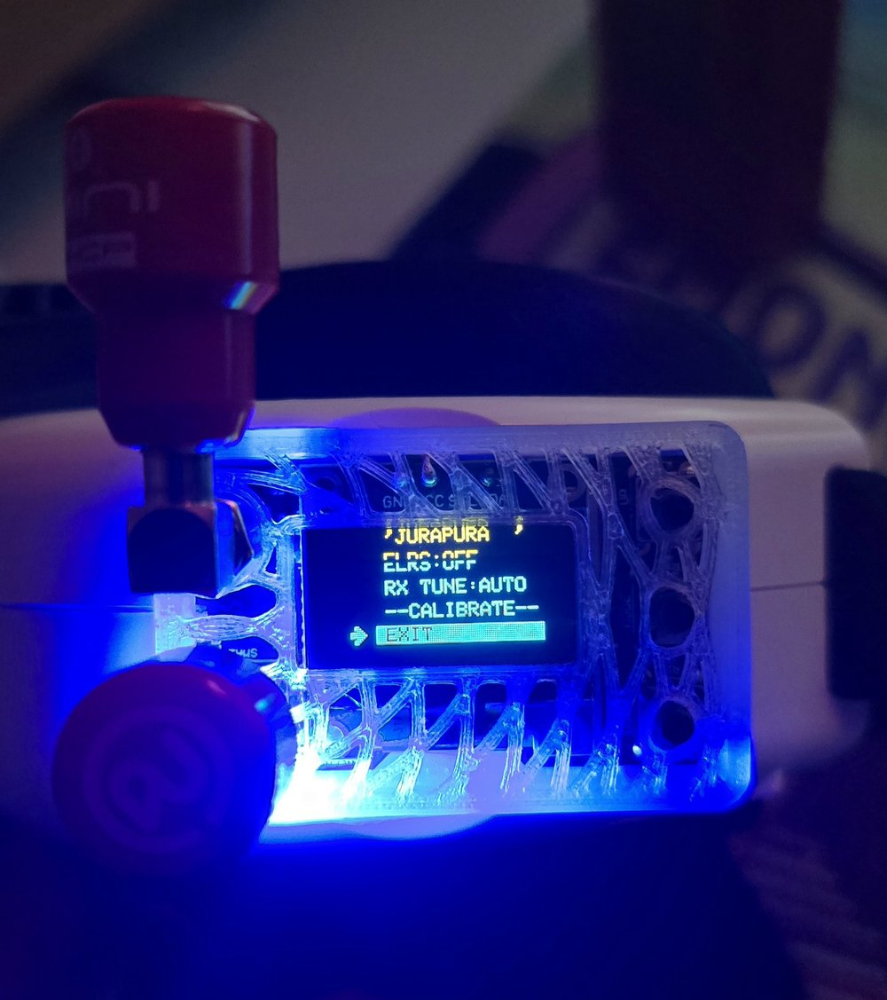

# True-D V3 mod firmware (unofficial)

Mod firmware for the **Furious FPV True-D V3** diversity receiver module (Fatshark-style goggle bay:
Fat Shark, Orqa FPV.One, HDZero and others), built on the stock 3.9D firmware.  It flashes like the
stock firmware, and the bootloader is never touched, so you can always go back.

> Unofficial.  Not made, endorsed or supported by Furious FPV.  Use it at your own risk; see
> [NOTICE.md](NOTICE.md).

<p align="center">
  
  <br>
  <em>A True-D V3 with this firmware, in a 3D-printed case on the goggles.  The Settings menu shows
  the new ELRS and RX TUNE items.</em>
</p>

**Download:** [`firmware/TrueD-MOD-1.17.hex`](firmware/TrueD-MOD-1.17.hex), or the latest
[release](../../releases).  The boot screen shows `MOD 1.17` under `TRUE-D REV 3.9`.

**New in 1.17: goggle control.**  The module follows the goggle's channel control: the **Orqa FPV.One** (both ways:
the goggle sets channel and band, and shows the module's channel), Fat Shark buttons, static channel pins, and
rapidFIRE senders such as the HDZero goggle with the 3-wire bay mod.  Settings → `BAY`; see
[docs/goggle-bay.md](docs/goggle-bay.md), and read its HDZero section before wiring an HDZero.

## What is better than stock

| | stock 3.9D | this firmware |
|---|---|---|
| **Diversity** | checks the receivers ~25 times a second, switches after 100–500 ms | checks both receivers ~4,500 times a second in an interrupt, switches within ~0.2–3.5 ms |
| **Flicker** | switches whenever the other receiver reads higher | stays put while the picture is good; a short lockout after each switch |
| **Antennas** | each receiver scaled to its own calibration maximum (a patch's real gain is scaled away) | each receiver measured above its own noise floor: 2 omnis, 2 patches or omni + patch all work |
| **Tuning** | fixed channel frequency | **RX TUNE**: centres both receivers on your VTX at every channel change |
| **Band scanner** | BEST rotates between neighbouring channels, names noise when no VTX is on | BEST names the VTX's own channel and its measured MHz; `--` when nothing is there |
| **Smart search** | every channel above 70 % of the calibrated level, in frequency order; weak VTXs missed | each VTX's own channel first, strongest first (weak VTXs too), then the other channels it was found on; Wi-Fi bursts filtered |
| **Quad finder** | silent below 70 % | beeps from ~6 %, faster the stronger; a line marks the highest level |
| **Antenna check** | — | the main menu shows each receiver's share of the time (`A62 B38`): a dead antenna stands out |
| **Goggle control** | the Dock-King link (drives a bay pin at 5 V for ~6 s at power-up) and Fat Shark up / down | `BAY:RAPIDFIRE` (rapidFIRE SPI: HDZero with the 3-wire mod, ExpressLRS backpack), `BAY:ORQA` (Orqa FPV.One, both ways), `BAY:1-8` (static channel pins), `BAY:STEP` (Fat Shark buttons); only `ORQA` ever drives a pin (DATA, low only) |
| **ELRS** | — | optional VRx backpack: the module follows VTX channel changes from your radio, telemetry on the OLED |
| **Sync mod** | — | optional LM1881: switches inside the sync pulses, invisible in the picture |
| **Beeps** | each beep freezes the module for 75 ms | play in the background |
| **L band** | 5362–5621 MHz | standard LowRace 5333–5613 MHz (same as ELRS and Betaflight) |

Plus fixes for stock bugs: smart search errors, the scanner and calibration readings, a boot hang
from bad saved data, reversed FILTER labels, display freezes, and more.

## Install

1. **Download** `TrueD-MOD-1.17.hex`.
2. **Connect** the True-D to the PC with its USB port, **outside the goggle**.  If an ELRS backpack is
   wired to D0, disconnect or unpower it first (D0 is shared with the USB serial line).
3. **Flash with XLoader:** device `Duemilanove/Nano(ATmega328)`, baud rate `57600`, the module's COM
   port, Upload.  Or with avrdude:
   ```
   avrdude -p m328p -c stk500v1 -b 57600 -P COM5 -D -U flash:w:TrueD-MOD-1.17.hex:i
   ```
   (COM10 and up: `-P \\.\COM10` with old avrdude versions.)
4. **Calibrate once** (below).  A unit coming from another firmware asks for it at power-up; OK
   keeps the old calibration.  Coming from MOD 1.13 or 1.15, the calibration stays valid.
5. **Choose `BAY`** for your goggle (Settings; [docs/goggle-bay.md](docs/goggle-bay.md)).  A unit coming from
   another firmware starts in `BAY:RAPIDFIRE`.

**Going back to stock:** flash the stock 3.9D hex the same way.  Your settings stay valid.

## Calibrate

1. Antennas on, exactly as you fly.
2. A VTX on at 25 mW, any channel, about 1–3 m in front of the module.
3. Settings → `--CALIBRATE--` → OK.  Three beeps.
4. Keep still for a few seconds: it sweeps every channel twice on both receivers.
5. When it succeeds it shows the result and continues with a smart search.  If it asks you to turn
   on the VTX, the signal was too weak: move the VTX closer and it starts again by itself.

## Settings

The menus and buttons work as in the stock firmware.  The Settings list scrolls:

| item | values | |
|---|---|---|
| `ALARM` | NONE / 20 / 35 / 50 % | RSSI alarm beep (stock) |
| `AUTO LOCK` | ON / OFF | lock the buttons 8 s after the last key (stock) |
| `FILTER` | LOW / NORMAL / HIGH | how calm the diversity is: LOW = fastest, HIGH = calmest (stock had the labels reversed); it also sets how deep a fade must be for an instant switch |
| name | 10 characters | the pilot name banner (stock) |
| `ELRS` | ON / OFF | ELRS VRx backpack on D0, default OFF |
| `RX TUNE` | AUTO / OFF | automatic receiver tuning, default AUTO |
| `BAY` | RAPIDFIRE / 1-8 / STEP / ORQA | how the goggle sets the channel, default RAPIDFIRE ([docs/goggle-bay.md](docs/goggle-bay.md)) |
| `BAY CLK` | D11 / D13 | the pin order of RAPIDFIRE and ORQA; leave it at D11 |
| `--CALIBRATE--` | | see above |

## Main screen

- **Channel box:** band and channel, and the frequency the receivers are tuned to.
- **Right of the channel box:** the RX TUNE offset measured at this channel change (`+2`, `-2`,
  `+0`), or `--` when it was not measured (no signal at that moment).  With the sync mod, `S` above
  and `V` below it show the line sync and the vertical sync.
- **Top line:** the pilot name, or ELRS telemetry (`LQ99 -67`, `16.4V 45%`, `1234MAH`) while the
  backpack sends it.
- **Main menu, bottom left:** the antenna check, `A62 B38`: how much of the time since the last
  channel change each receiver was in use, counted while the signal was weak enough for the choice to
  matter.  It appears once the signal has faded a few times
  (in flight, or walking away with the quad); on the bench with a strong signal there is nothing to
  compare, so it stays empty.  Both antennas fine: roughly even; a dead antenna or receiver: ~0 %.

## RX TUNE

VTXs and receivers are often a few MHz apart, and every VTX differently.  At every channel change
(also at power-up, at the end of a scan or search, and when you switch RX TUNE on) the module
measures where the VTX really is and moves both receivers to the nearest 2 MHz step, up to ±6 MHz.
The receiver's synthesizer works in 2 MHz steps, so finer tuning is not possible on this hardware.

- **When:** only at a channel change.  Nothing starts a measurement in flight by itself: not a signal
  dropout, not a returning signal, not a timer.
- **Cost:** 0.14–0.21 s from the change to the result, with the picture briefly blanked a few times.
- **Lists** (ALL, SAVED, SEARCH): stepping through tunes each channel at once with its stored offset;
  the measurement follows after 0.4 s on a channel.
- **Power-up:** the receivers are tuned before the boot screen, so the picture is there at once; the
  measurement follows after the boot screen.
- **Swapped quads on the same channel:** step one channel away and back to measure the new VTX.
- **No signal at the change** (quad switched on after the goggles): `--`, and the last offset for
  that channel stays.  Step away and back once the quad is on.
- **Cold VTX:** VTXs drift a little while they warm up; re-measure (away and back) if you like.

## Band scanner and smart search

- **Band scanner:** BEST is the channel whose frequency is nearest the middle of the strongest VTX's
  signal, and the measured MHz is shown under it.  It changes only when two sweeps agree, and shows
  `--` when nothing is clearly above the noise.  Channels only 1–5 MHz apart (e.g. B1/R3, R1/E3) are
  closer than a VTX's own frequency error, so read the MHz too.
- **Smart search:** lists each VTX's own channel first, strongest first, then the other channels the
  same VTXs were found on (as stock).  It finds VTXs down to 20 % of the calibrated range (stock: 70 %),
  and every channel is read twice, so a Wi-Fi burst is not listed as a VTX.
- **Quad finder:** the stronger receiver's level as a bar and a percentage.  It beeps from ~6 %, faster
  the stronger, and a line marks the highest level since you opened it: walk back when the bar drops
  below the line.

## Optional hardware

- **ELRS VRx backpack:** an ESP8285 / ESP-01F ELRS backpack flashed with the stock **TBS Fusion**
  VRx target; its TX to the True-D's ATmega328P PD0 / RXD, plus GND and power.  Then Settings →
  `ELRS:ON`.  See [docs/elrs-backpack.md](docs/elrs-backpack.md).
- **Sync mod:** an LM1881 sync separator on the switched video, its sync outputs to PD2 and PD3.
  About €2–3 of parts, no firmware change.  See [docs/sync-mod.md](docs/sync-mod.md).
- **No-LED bootloader (optional, extra safety):** removes the stock bootloader's 0.1 s 5 V pulse on bay pin 3 at
  power-up, for goggles whose processor pins are wired to the bay.  Needs a second (5 V) Arduino as the programmer
  and one wire soldered to C10 inside the module.  See [docs/bootloader.md](docs/bootloader.md).

## Status

- Tested on one True-D V3: bench tests, a walk with the quad, RSSI recordings of the receivers
  (noise floor, lock times, passband, fading), and a multi-agent code review with every finding
  verified.
- MOD 1.15 was tested on the unit feature by feature, driven from a PC (keys, screen dumps, the raw RSSI
  stream; the PC also played the ELRS backpack), and checked in a board simulator that runs the real
  firmware image against modelled receivers, VTXs, fading, goggles, an ELRS backpack and an LM1881.
- MOD 1.17's goggle control was tested on the unit in an Orqa FPV.One (`ORQA`, `1-8`, `STEP`) and in the board
  simulator against models of the HDZero goggle, the ExpressLRS backpack and the Orqa, with noise, wrong wiring
  and other protocols (1,120 checks).  `RAPIDFIRE` has not met a real HDZero or ExpressLRS backpack yet.
- **Not yet flight-tested** against stock with a DVR.
- The ELRS backpack and the sync mod are implemented and reviewed, but not yet tried with real
  hardware.

Reports are welcome in the [issues](../../issues).

## Changes

See [CHANGELOG.md](CHANGELOG.md).
